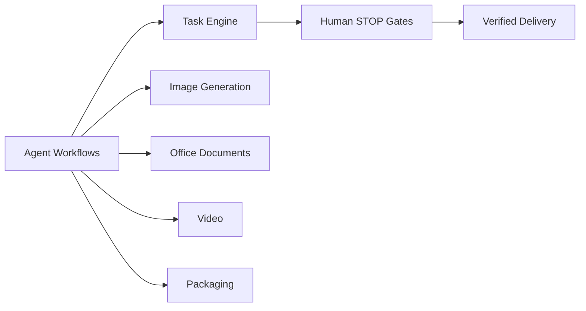

## 🔥 Streak

## 🐍 Contribution Graph

<picture>
  <source media="(prefers-color-scheme: dark)" srcset="https://raw.githubusercontent.com/qiuy-collab/snake/output/github-contribution-grid-snake-dark.svg" />
  <source media="(prefers-color-scheme: light)" srcset="https://raw.githubusercontent.com/qiuy-collab/snake/output/github-contribution-grid-snake-light.svg" />
  
</picture>

## 🌳 What I Build

## 🚀 Featured Projects

| Project | Description | Stack |
| --- | --- | --- |
| [**AutoFlow.skill**](https://github.com/qiuy-collab/AutoFlow.skill) | General task-engine Skill |   |
| [**weone**](https://github.com/qiuy-collab/weone) | WeChat companion agent |  |
| [**imageplayground**](https://github.com/qiuy-collab/imageplayground) | GPT / Gemini image generation & editing playground |   |

## 📫 Reach Me

